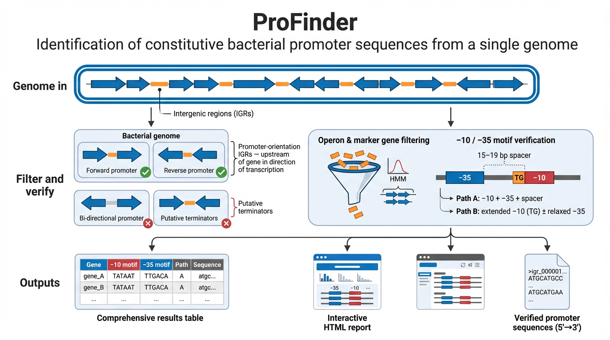

# ProFinder



ProFinder extracts high-confidence constitutive promoter candidates from a single bacterial or archaeal genome assembly. Given a FASTA file, it returns a curated shortlist of promoter sequences upstream of conserved single-copy housekeeping genes, oriented 5'→3' and ready for use in expression constructs, reporter systems, or metabolic engineering.

## Access the server

[ProFinder Web Interface](https://services-ab.cs.uni-tuebingen.de/profinder/)


## How the pipeline works

ProFinder applies a series of biologically motivated filters to find promoters upstream of single-copy phylogenetic marker genes that are conserved across diverse bacteria and archaea: ribosomal proteins, tRNA synthetases, RNA polymerase subunits, DNA replication and repair components, translation factors, and similar housekeeping functions. Because these genes are usually constitutively and highly expressed, their promoters are desirable for broad microbial genetic system applications.

The pipeline annotates a genome with [Prokka](https://github.com/tseemann/prokka) (run with `--rfam`, so non-coding RNA features bound intergenic regions), extracts intergenic regions (IGRs) between annotated features, identifies operons with a two-pass proximity / flanking-distance algorithm, and screens for marker genes via `hmmsearch` against 98 bundled HMM profiles. Candidate promoters are then verified by scanning for −10 and −35 hexamer motifs with a 16–18 bp spacer, using position weight matrices scored against the composition of the genome being scanned. Significance is established empirically against a per-genome dinucleotide-shuffle null; each call carries a length-standardised score, a shortlist ranking score, and - when a held-out calibration is supplied - a calibrated positive-predictive value. A final results table and an HTML report are produced.

ProFinder reports two promoter sets from every run: a genome-wide catalogue of every motif-confirmed promoter-orientation IGR, and the marker-gene-constrained subset. The marker subset is the main deliverable.


## Requirements

ProFinder needs Python ≥ 3.9, [Prokka](https://github.com/tseemann/prokka) ≥ 1.14.6, and [HMMER](http://hmmer.org/) (specifically `hmmsearch`). The −10/−35 scan reads MEME-format motif files directly in Python, so the MEME suite is **not** required. HMM profiles and the motif file are bundled with the package.

Python dependencies: `pandas ≥ 1.3`, `numpy ≥ 1.20`, `biopython ≥ 1.79` (listed in `pyproject.toml` and `requirements.txt`). `scipy` is optional (used only for an optional generalised-Pareto tail refinement in the empirical null). `matplotlib` is optional and only used to render the figure in the p-value-sweep diagnostic.


## Installation

**1. Create the environment and install the external tools**

```bash
conda create -n profinder -c conda-forge -c bioconda \
    python=3.12 "prokka>=1.14.6" hmmer pip -y
conda activate profinder
```

List conda-forge before bioconda, as bioconda requires, and keep the Prokka pin: without it some solvers (for example mamba 1.5) resolve Prokka 1.13, which misreads current BLAST releases as too old and cannot annotate. ProFinder checks the Prokka version before step 1 and stops with this advice if it is older than 1.14.6.

**2. Clone and install ProFinder**

```bash
git clone https://github.com/marshomics/profinder.git
cd profinder
pip install .
```

This pulls in the Python dependencies via pip and registers the `profinder` command. All bundled data (HMM profiles, motif file) is installed as package data alongside the Python modules.

For development (editable install):

```bash
pip install -e .
```

Optional diagnostic figure support:

```bash
pip install ".[diagnostics]"     # adds matplotlib for --diagnose-p-sweep
```

**3. Verify the installation**

```bash
profinder --list          # prints the 11 pipeline steps
prokka --version          # should print 1.14.6 or later
hmmsearch -h | head -1     # should print the HMMER version
```

**Alternative: separate conda environments**

If bioconda's Prokka conflicts with other packages, install each tool in its own environment and point ProFinder at them:

```bash
conda create -n prokka_env -c conda-forge -c bioconda "prokka>=1.14.6" -y
conda create -n hmmer_env  -c conda-forge -c bioconda hmmer -y

conda create -n profinder -c conda-forge python=3.12 pip -y
conda activate profinder
pip install .

profinder -i genome.fasta -o results/ \
    --conda-prokka prokka_env \
    --conda-hmm hmmer_env
```


## Quick start

Bacterial genome (default):

```bash
profinder -i my_genome.fasta -o results/
```

Archaeal genome (sets Prokka `--kingdom Archaea`):

```bash
profinder -i my_genome.fasta -o results/ --domain archaea
```

Append the first 90 nt of each downstream CDS to the final-table sequence:

```bash
profinder -i my_genome.fasta -o results/ --cds-bp 90
```

Batch mode (multiple genomes from a TSV table):

```bash
profinder --batch samples.tsv -o results/
```

The pipeline checkpoints at each step. Re-running the same command skips completed steps. Use `--force` to re-run everything.

**Input.** A nucleotide genome FASTA (optionally gzipped) with unique contig IDs. Contig IDs longer than Prokka's 37-character limit are shortened for Prokka and restored in every ProFinder output; `prokka/contig_id_map.tsv` records the mapping. ProFinder stops with a message naming the problem, before any annotation, on an empty, protein or duplicate-ID FASTA; it also stops when a step's inputs are missing (for example `--start 8` in a directory where steps 1–7 never ran) or when `hmmsearch` cannot run, rather than writing empty or unscreened results.


## Pipeline steps

`profinder --list` prints the 11 steps below. Intermediates are written into per-stage subdirectories (`igr/`, `hmm/`, `operons/`, `motifs/`); only the final deliverables sit at the top level of the output directory.

| Step | Description | Key output |
|------|-------------|------------|
| 1 | Run Prokka (`--rfam`) | `prokka/genome.gff`, `prokka/genome.faa` |
| 2 | Extract intergenic regions | `igr/igr_summary.tsv`, `igr/intergenic_regions.fasta` |
| 3 | Identify operons | `operons/operons.tsv` |
| 4 | Run hmmsearch (98 profiles) | `hmm/tblout/*.tblout` |
| 5 | Filter HMM output | `hmm/hmm_filtered.tsv` |
| 6 | Filter operons + add markers | `operons/operons_filtered_markers.tsv` |
| 7 | Match IGRs to marker operons | `operons/promoter_markers.tsv`, `operons/promoter_markers_hmm.tsv` |
| 8 | Scan promoter motifs (−10/−35, paths A–C) | `motifs/motif_best_all.tsv`, `motifs/promoter_markers_verified.tsv`, `all_promoters_verified.fasta`, `marker_promoters_verified.fasta` |
| 9 | Annotate CDS (Prokka) | `cds_annotations.tsv` |
| 10 | Build final output table | `profinder_results.tsv` |
| 11 | Generate HTML report | `promoter_report.html` |

Step 8 scans two sets independently against the same calibrated motifs. First, all promoter-orientation IGRs (tandem+ / tandem-) are screened for −10/−35 combinations, producing a genome-wide catalogue of motif-confirmed promoters regardless of marker status. Second, the marker-filtered subset (from step 7) is scanned, producing verified marker promoters with motif details merged onto the original metadata.


## IGR orientation logic

Each intergenic region is classified by the strand orientation of its flanking genes:

**tandem+** (→ IGR →): both genes on the + strand. The IGR lies upstream of the right (downstream) gene in the direction of transcription. The sequence is already 5'→3'.

**tandem-** (← IGR ←): both genes on the − strand. The IGR lies upstream of the left (downstream) gene, which runs right to left. The sequence is reverse-complemented to 5'→3'.

**DP** (← IGR →): genes point away from each other. Contains promoters for both flanking genes, but the promoter–gene assignment is ambiguous without experimental data.

**CONV** (→ IGR ←): genes point toward each other. Sits between two stop codons and does not carry a promoter for either flanking gene.

Tandem+ and Tandem- are the **promoter-orientation** IGRs carried into the motif scan and the final table; DP and CONV are excluded from those outputs. In the output tables and FASTA headers these four classes appear under their internal labels `CO_F` (tandem+), `CO_R` (tandem-), `DP` and `CONV`. Boundary features used to define IGRs include CDS and all Prokka `--rfam` non-coding RNA classes (tRNA, rRNA, tmRNA, ncRNA, misc_RNA), and any window overlapping an annotated feature is rejected, so IGRs never sit inside or across a non-coding gene. An IGR is kept only when its downstream (promoter-target) gene is a CDS, rRNA, or tRNA — the classes that carry strong constitutive promoters (rRNA and tRNA operons include the rrn P1/P2 promoters). An IGR that would only drive a tmRNA, ncRNA, or misc_RNA is dropped, while those features still serve as boundaries for neighbouring IGRs. Only IGRs of length 81–1000 bp (configurable) are kept.

## Motif-based promoter verification

Step 8 verifies candidate promoters by scanning for the −10 and −35 hexamer elements using position weight matrices (PWMs) from the bundled `all_unique_subgroups.meme` file. That file holds 72 paired subgroups (`M001_m10` / `M001_m35` … `M072`), where the prefix identifies the subgroup and the `_m10` / `_m35` suffix the element type.

**Per-genome background.** Each frequency matrix is converted to a log₂-odds PWM scored against the A/C/G/T composition of the input genome (computed from the Prokka `.fna`, or the input FASTA), not a fixed uniform background. This background is a *scoring* choice; significance itself is established empirically (see below), so it no longer depends on it. The uniform background written in the MEME header is present only for compatibility with other MEME-format tools.

**Empirical element thresholds.** The score threshold at each target level (`--p10`, `--p35`, `--p35-relaxed`) is read as a quantile of a **per-genome null** rather than from a closed-form calculation. Every scanned IGR is shuffled while preserving its exact dinucleotide composition (Altschul–Erikson Eulerian-path shuffle), the motifs are scored across the shuffled sequences, and both the thresholds and the per-element empirical quantiles reported for each hit (`emp_p_10` / `emp_p_35`) are read from that null. To give each threshold a stable sample, nulls are pooled within strata of (length × dinucleotide composition). This replaces the earlier analytic enumeration of all 4⁶ hexamer scores under a mononucleotide background — the per-position analytic p-value it produced is a multiple-testing artifact at genome scale, and is no longer used.

**Orientation-aware scanning.** Tandem+ / Tandem- IGRs are scanned on the + strand of the already-oriented sequence only, because a − strand motif would describe a promoter pointing away from the downstream marker gene. DP IGRs would be scanned on both strands.

**Distance-to-CDS cutoff.** A −10 hit whose right edge sits more than `--max-dist-to-cds-start` bp (default 300) from the downstream CDS start is dropped before the spacer search. This captures the bulk of literature σ⁷⁰ leader lengths while removing distal motifs in long IGRs that are unlikely to drive the downstream gene.

**Recognition paths.** Each surviving −10 hit is classified into one of three paths, in priority order. Paths A–C require a −35 hit with a 16–18 bp spacer (canonical σ⁷⁰ spacer is 17 ± 1 bp):

**Path A** — a strict −35 from the *same* subgroup as the −10 (linked pair).
**Path B** — an extended −10 (the canonical "TGn" motif: a TG dinucleotide one base 5' of the hexamer, i.e. TSS positions −15/−14 for a hexamer at −12..−7) plus a *relaxed* −35 from the same subgroup.
**Path C** — a strict −35 from a *different* subgroup (unlinked).

Default element thresholds (as null quantiles): `--p10` 1e-2 for −10 hits, `--p35` 1e-3 for strict −35 hits (paths A and C), `--p35-relaxed` 3e-2 for the relaxed −35 used only in path B. The CLI reads these defaults from `profinder/config.py`, so `profinder --help` always shows the values actually applied.

When several subgroups exceed threshold at one position, the most significant (lowest empirical quantile) is reported, with raw log-odds as the tiebreaker. Path A is tested directly on the −10's own subgroup (does *that* subgroup have a strict −35 at the spacer-linked site), so a linked pair is never demoted to path C merely because a different subgroup scores marginally higher at the same −35 site. The single best hit per IGR is chosen by path rank (A > B > C), then by combined element significance −log₁₀(emp_p₁₀) + −log₁₀(emp_p₃₅). For path C, emp_p₃₅ is Šidák-adjusted for the number of other subgroups searched (`motif_p35_multiplicity_k`); the raw value is kept in `motif_emp_p_35_uncorrected`.

**Per-call score, shortlist ranking and calibrated confidence.** Each call also gets a single **length-standardised score** (`score_std`): the best combined −log₁₀ empirical quantile of a spacer-linked −10/−35 pair over the interval, minus the shuffle null's location fitted on log(n_pairs) (a longer interval offers more chances for a high score; this removes that length dependence without the over-correction a closed-form Šidák bound would impose). `score_std` is the threshold statistic and the calibration input, but it is **not** the ranking quantity: on the 49-genome panel, sorting on it alone ranked calls no better than chance.

Ranking uses `shortlist_score` (0–1, higher first), a logistic ranker over the call's features (element significances, `score_std`, spacer, n_pairs, GC, IGR length, distance to CDS, subgroup ranks, path, extended −10, orientation) fitted on 49 genomes against "interval contains an annotated intergenic TSS" and validated leave-one-genome-out (see `profinder/ranker.py`; coefficients ship in `profinder/promoter_ranker.json`). `profinder_results.tsv`, the per-sweep tables and the HTML report are all ordered by it (called IGRs first, uncalled IGRs after in genomic order). Its order is validated; its value is not a calibrated probability. If the ranker spec is missing, `shortlist_score` is blank and the tables fall back to path rank then combined significance.

A calibration fitted on **held-out genomes** (a `Calibration` JSON written by `profinder.empirical.Calibration.fit(...).to_json(...)`; no calibration is bundled by default, and the fitting script is not part of this package) maps `(path, score_std)` to two reported quantities:

- `lr_pos` — the **positive likelihood ratio**, base-rate-free, so it does not assume a promoter prevalence.
- `ppv_interval` — the probability that the **interval carries a promoter** (not that the reported coordinates are exactly the promoter), derived from `lr_pos` only against an explicitly stated prevalence prior (`--prior`).

## CDS extension (`--cds-bp`)

By default the final table reports the promoter sequence only. `--cds-bp N` appends the first N nucleotides of the downstream CDS, adding a `sequence_5p_to_3p_cds` column to `profinder_results.tsv` (and to the per-sweep tables in diagnostic mode). The FASTA outputs are unaffected.

For Tandem+ promoters the CDS sits on the + strand immediately after the IGR, so the first N bp are read directly from the forward strand. For Tandem- promoters the CDS is on the − strand immediately before the IGR, so the first N bp are extracted upstream of the IGR start and reverse-complemented. In both cases the result is the first N coding nucleotides in the 5'→3' reading direction, appended to the 5'→3' promoter sequence. If N is not a multiple of 3, the run prints an in-frame warning. Set `--cds-bp 0` (the default) to disable.

## Diagnostic mode (`--diagnose-p-sweep`)

Choosing `--p10` and `--p35` is consequential: yield can change by an order of magnitude across reasonable settings. The diagnostic runs the p-value-independent prerequisites (steps 1–7 and step 9), then scans every tandem+ / tandem- IGR across a range of thresholds in three modes — `matched` (p10 = p35), `p10_only`, and `p35_only` — and writes:

```
diagnostics/p_sweep.tsv          per-sweep summary counts
diagnostics/p_sweep.png          3-panel figure (requires matplotlib)
diagnostics/sweep_tables/        one profinder_results.tsv per (mode, p10, p35),
                                 pre-filtered to motif_confirmed and path A/B
```

Each per-sweep-point table shares the column layout of the canonical `profinder_results.tsv`, so it can be consumed directly by downstream benchmarking. The sweep range and granularity are set by `--sweep-min`, `--sweep-max`, `--sweep-n`, `--sweep-modes`, and `--sweep-p35-relaxed-ratio`.


## Batch mode

`--batch` accepts a tab-separated table with these columns:

| Column | Required | Description |
|--------|----------|-------------|
| `sample_id` | yes | Unique identifier for each sample |
| `fasta` | yes | Path to genome FASTA |
| `gff` | no | Path to existing GFF3 (skips Prokka if provided with `faa`) |
| `faa` | no | Path to existing protein FASTA |
| `fna` | no | Path to existing nucleotide FASTA |

Each sample is processed independently in its own subdirectory under the output directory. When `gff` and `faa` are provided, Prokka (step 1) is skipped and the supplied files are symlinked into place.


## CLI reference

```
profinder -i FASTA -o DIR [options]
profinder --batch TABLE -o DIR [options]

Input (mutually exclusive):
  -i, --input              Input genome FASTA (single-sample mode)
  --batch                  TSV table for batch mode

Output:
  -o, --output             Output directory (default: output/)

Domain:
  --domain {bacteria,archaea}
                           Target domain; sets Prokka --kingdom
                           (default: bacteria)

Step control:
  --start N                First step to run (default: 1)
  --end N                  Last step to run (default: 11)
  --list                   List steps and exit
  --force                  Re-run all steps, ignoring checkpoints

Tool paths:
  --prokka PATH            Prokka binary (default: prokka)
  --hmmsearch PATH         hmmsearch binary (default: hmmsearch)
  --hmm-dir DIR            Directory of individual .hmm profile files
                           (default: bundled profinder/hmms/)

Motif scanning:
  --meme-file FILE         MEME file with paired M###_m10 / M###_m35
                           subgroup motifs
                           (default: bundled all_unique_subgroups.meme)
  --p10 F                  −10 element threshold, as a null quantile
                           (default: 1e-2)
  --p35 F                  Strict −35 threshold, paths A and C
                           (default: 1e-3)
  --p35-relaxed F          Relaxed −35 threshold, path B only
                           (default: 3e-2)
  --max-dist-to-cds-start N
                           Max bp from the −10 right edge to the downstream
                           CDS start; farther hits are dropped (default: 300)
  --n-shuffles N           Dinucleotide-preserving shuffles per interval for
                           the per-genome empirical null (default: 10)
  --ppv-calibration FILE   Per-path PPV/LR+ calibration JSON (a
                           Calibration.to_json file). Default: bundled if present,
                           else uncalibrated (lr_pos / ppv_interval blank)
  --prior F                Promoter-prevalence prior used to turn lr_pos into
                           ppv_interval. Omit to report lr_pos only

Conda environments:
  --conda-prokka ENV       Conda env for Prokka
  --conda-hmm ENV          Conda env for hmmsearch

Parameters:
  --threads N              Threads for external tools (default: 4)
  --kingdom STR            Prokka kingdom (default: Bacteria; auto-set
                           to Archaea when --domain archaea)
  --prefix STR             Prokka output prefix (default: genome)
  --igr-min N              Minimum IGR length in bp (default: 81)
  --igr-max N              Maximum IGR length in bp (default: 1000)
  --max-internal-dist N    Max gap within an operon in bp (default: 25)
  --min-flanking-dist N    Min gap at operon boundaries in bp (default: 75)
  --hmm-bitscore F         Minimum HMM bitscore (default: 25.0)
  --cds-bp N               Append first N nt of downstream CDS to the final
                           table sequence column (default: 0, disabled)

Diagnostic (p-value sweep):
  --diagnose-p-sweep       Run the threshold sweep after step 7 instead of
                           steps 8, 10, 11
  --sweep-min F            Smallest swept p-value (default: 1e-5)
  --sweep-max F            Largest swept p-value (default: 1e-1)
  --sweep-n N              Number of log-spaced sweep points (default: 13)
  --sweep-modes LIST       Comma-separated modes (default:
                           matched,p10_only,p35_only)
  --sweep-p35-relaxed-ratio F
                           p35_relaxed = ratio × p35, capped at 1.0
                           (default: 20.0)
```


## Output structure

```
output/
├── prokka/                              # Prokka annotation files
├── igr/                                 # Intergenic region extraction
│   ├── igr_summary.tsv
│   └── intergenic_regions.fasta
├── hmm/                                 # HMM marker screening
│   ├── tblout/                          # per-profile hmmsearch output
│   ├── hmm_combined.tsv
│   └── hmm_filtered.tsv
├── operons/                             # Operon identification + marker matching
│   ├── operons.tsv
│   ├── operons_filtered.tsv
│   ├── operons_filtered_markers.tsv
│   ├── promoter_markers.tsv             # marker promoters (one row per IGR)
│   └── promoter_markers_hmm.tsv         # marker promoters × HMM profiles
├── motifs/                              # Motif scan
│   ├── motif_best_all.tsv               # best motif hit per IGR (all)
│   ├── motif_best_markers.tsv           # best motif hit per IGR (markers)
│   └── promoter_markers_verified.tsv    # motif-confirmed marker promoters
├── all_promoters_verified.fasta         # motif-confirmed promoters, all (5'→3')
├── marker_promoters_verified.fasta      # motif-confirmed marker promoters (5'→3')
├── cds_annotations.tsv                  # CDS product names from Prokka
├── profinder_results.tsv                # comprehensive results table
└── promoter_report.html                 # visual HTML report (top 10 promoters)
```

The HTML report lists the top 10 motif-verified marker promoters, ordered by `shortlist_score` (fallback: motif path A→B→C then combined −log₁₀(p) when no ranker spec is available). Each promoter's sequence diagram is drawn proportional to its actual length and aligned on the 3' (gene-proximal) end, so the −10/−35 elements line up across rows.

In `--diagnose-p-sweep` mode, steps 8, 10, and 11 are replaced by a `diagnostics/` directory (see Diagnostic mode above).

Tandem- FASTA records are reverse-complemented so every sequence is oriented 5'→3'. The `profinder_results.tsv` table contains one row per promoter-orientation IGR (motif-confirmed rows first, ordered by `motif_shortlist_score` descending; unconfirmed rows follow in genomic order), with these columns:

```
promoter_id, contig, start, end, length, orientation,
associated_cds, gene_name, locus_tag, product,
is_marker, motif_confirmed, motif_path,
motif_source_10, motif_source_35, motif_has_ext10,
motif_emp_p_10, motif_emp_p_35,
motif_emp_p_35_uncorrected, motif_p35_multiplicity_k,
motif_seq_10, motif_seq_35,
motif_pos_10, motif_pos_35, motif_spacer,
motif_score_std, motif_n_pairs, motif_shortlist_score,
motif_lr_pos, motif_ppv_interval, motif_in_domain,
sequence_5p_to_3p   [, sequence_5p_to_3p_cds when --cds-bp > 0]

(motif_lr_pos / motif_ppv_interval / motif_in_domain are blank unless a
calibration is supplied via --ppv-calibration.)
```

`promoter_markers_hmm.tsv` expands the marker promoters so each IGR × HMM-profile combination gets its own row, letting you see every HMM association for each marker promoter.


## Bundled data

```
profinder/
├── all_unique_subgroups.meme    # 72 paired M###_m10 / M###_m35 motif subgroups
├── promoter_ranker.json          # fitted shortlist ranker (required by ranker.py)
├── hmms/                         # 98 single-copy marker-gene HMM profiles
│   ├── Ribosomal_L20_8b522e5f.hmm
│   ├── RNA_pol_A_bac_5767a6d9.hmm
│   ├── TIGR00472_1cfca671.hmm
│   └── ...
└── motifs/
    └── all_unique_subgroups.meme  # copy of the motif file
```

The HMM set spans ribosomal proteins, tRNA synthetases, RNA polymerase subunits, DNA replication and repair, cell division, and translation factors — single-copy genes conserved across the bacterial and archaeal tree. By default ProFinder reads the motif file from the package root; `profinder/motifs/` holds an identical copy.

The profile HMMs and motif matrices are **derived from third-party sources** and are not covered by ProFinder's own licence — see [Bundled data provenance](#bundled-data-provenance).


## Citation

If you use ProFinder, please cite both the software release and the paper.

> Gautam, A. and Marsh, J.W. ProFinder: candidate constitutive promoter prediction across the
> bacterial tree for genetic tool development in non-model species. *Nucleic Acids Research*
> (in press).


## License

### Software

ProFinder's source code is released under the [MIT License](LICENSE), © 2026 James Marsh.

### Bundled data provenance

The package ships model files that ProFinder redistributes rather than authors. **These are not
covered by the MIT licence above.** Each retains the terms of its original distribution, and anyone
redistributing ProFinder — or reusing these files independently — should check those terms at the
source.

| Bundled file | What it is | Origin |
|---|---|---|
| `profinder/hmms/*.hmm` | 98 profile HMMs, one representative per marker family | Pfam and TIGRFAM profile HMMs, plus unaccessioned models from the marker sets below. The 98 families comprise 187 constituent profiles, of which 60 carry TIGRFAM accessions and 20 carry Pfam accessions. |
| `all_unique_subgroups.meme` (and the copy under `profinder/motifs/`) | 72 paired −10 / −35 position weight matrices | Fitted here from the experimentally mapped TSS and promoter compilation of Kuo et al. (2025), *Nucleic Acids Research* 53:gkaf1310 |
| `profinder/promoter_ranker.json` | Fitted logistic shortlist ranker | Original to this work; covered by the MIT licence |

Marker-family membership was determined across ten published single-copy marker-gene sets. The
bundled selection draws on all ten:

| Set | Genes | Reference |
|---|---|---|
| Cic31 | 31 | Ciccarelli et al. (2006) |
| Cre40 | 40 | Creevey et al. (2011) |
| Dup107 | 107 | Dupont et al. (2012) |
| PhyEco | 114 | Wu et al. (2013) |
| Aln36 | 36 | Alneberg et al. (2014), CONCOCT |
| Lan73 | 73 | Lan et al. (2016) |
| bac120 | 120 | Parks et al. (2017), GTDB |
| Col61 | 61 | Coleman et al. (2021) |
| UBCG2 | 81 | Kim et al. (2021) |
| Tia85 | 85 | Tian and Imanian (2023) |

Pfam and TIGRFAM models are distributed through [InterPro](https://www.ebi.ac.uk/interpro/)
(EMBL-EBI). GTDB releases its data under CC BY-SA 4.0 and its software under GPL-3.0
([gtdb.ecogenomic.org/licenses](https://gtdb.ecogenomic.org/licenses)). `bac120` contributed
marker-set membership to the family selection here; the profile HMMs bundled under `hmms/` are
Pfam and TIGRFAM models, not GTDB's. ProFinder neither uses nor redistributes GTDB software, so
the GPL-3.0 terms do not reach it. If you redistribute the bundled `hmms/` directory, keep this
section with it.

### External tools

ProFinder invokes [Prokka](https://github.com/tseemann/prokka) (GPL-3.0) and
[HMMER](http://hmmer.org/) (BSD-3-Clause) as external programs. It neither links against nor
redistributes them, so their licences do not extend to ProFinder; install them separately and
observe their terms. The MEME suite is not required — MEME-format motif files are parsed directly
in Python.
